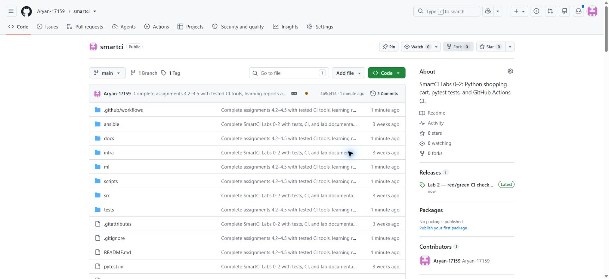
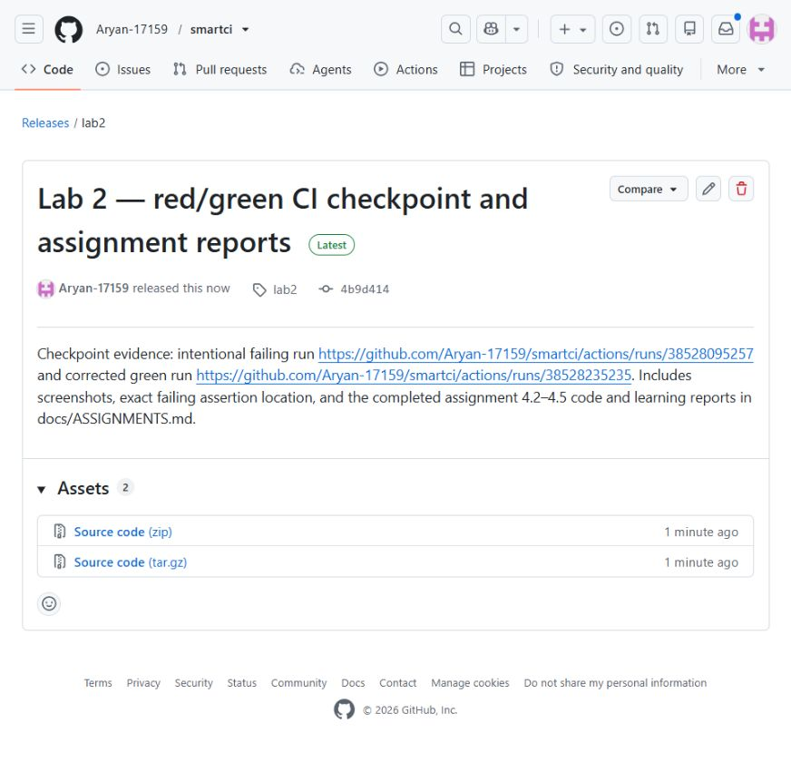
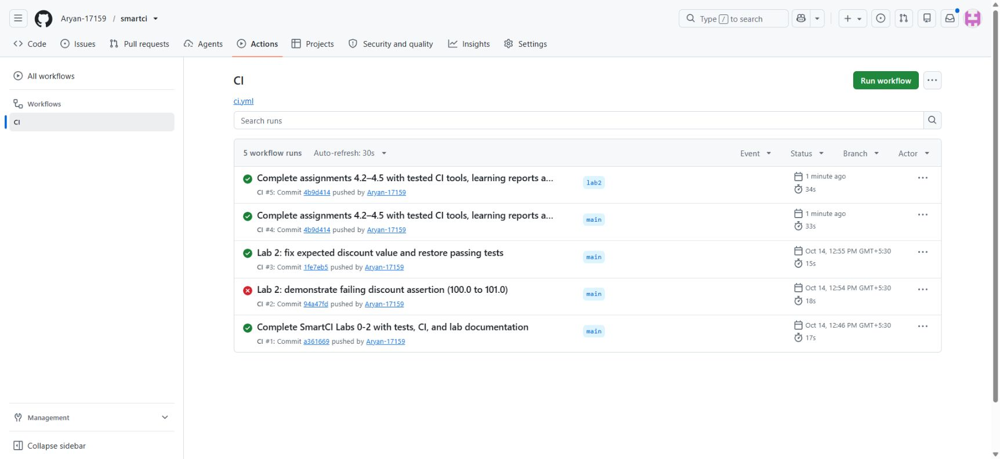
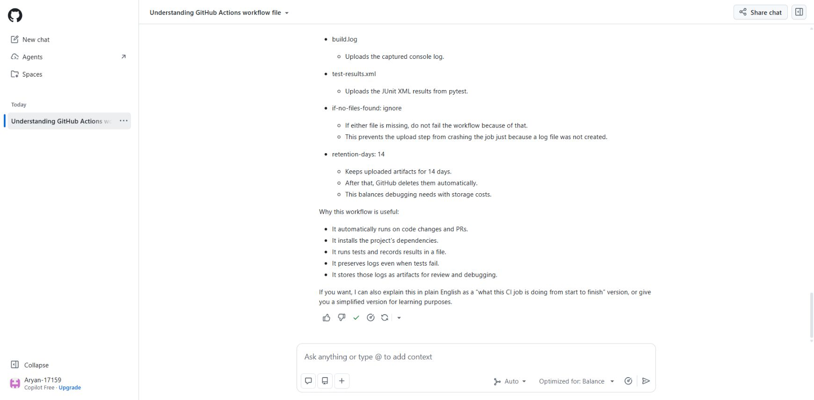

# Remote completion evidence — 2026-11-01
[CI run #4](https://github.com/Aryan-17159/smartci/actions/runs/41313209175) succeeded in 33 seconds. Its full test suite passed all 62 tests in 1.17 seconds. Cache compilation, routing, disposable experiments, prediction training/evaluation, deterministic log extraction and artifact upload all succeeded.

[lab2 release](https://github.com/Aryan-17159/smartci/releases/tag/lab2) points at 4b9d414. It includes the code and learning reports; subsequent documentation commits add final screenshots and Copilot evidence.

[Actual Copilot response](COPILOT_RESPONSE.md) completes the earlier blocked exercise. The answer was reviewed and minor wording corrections are noted at its top.

The [manual LLM run #6](https://github.com/Aryan-17159/smartci/actions/runs/41313368978) also succeeded: actual model inference returned 1 failed, 27 passed from the historical red log. Replaying its error marker created a misleading annotation despite success; console markers are now neutralized while the JSON artifact preserves original evidence.

