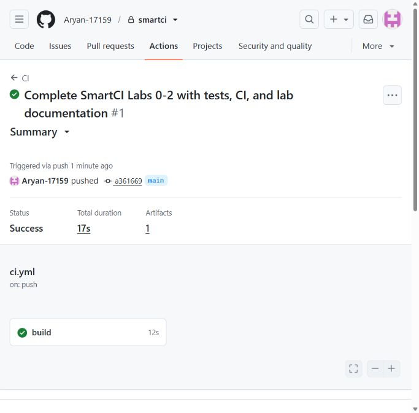
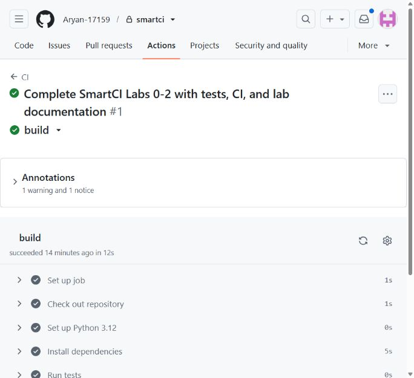
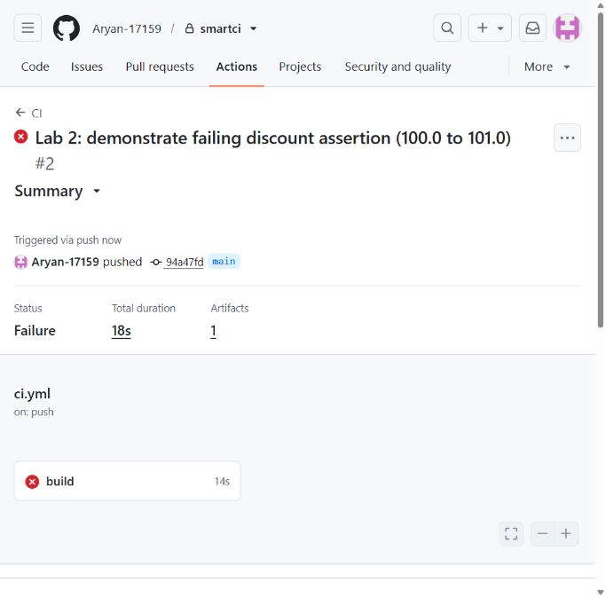
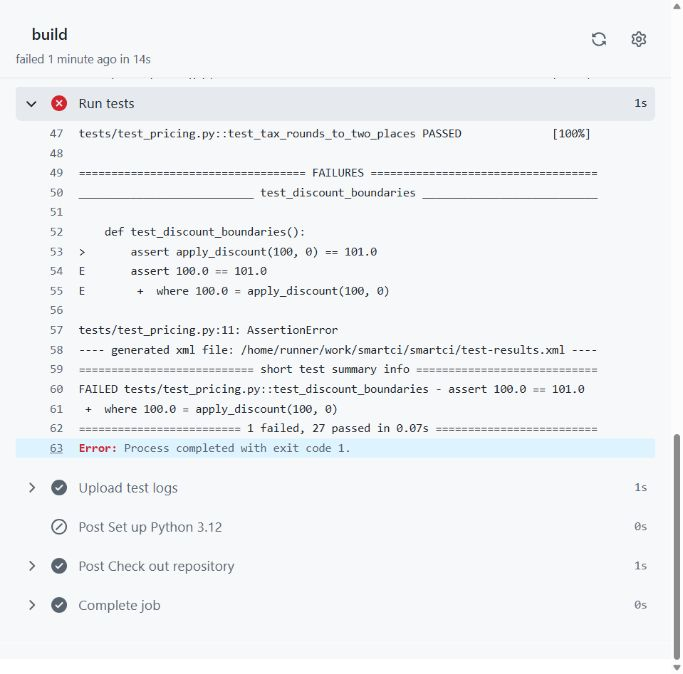
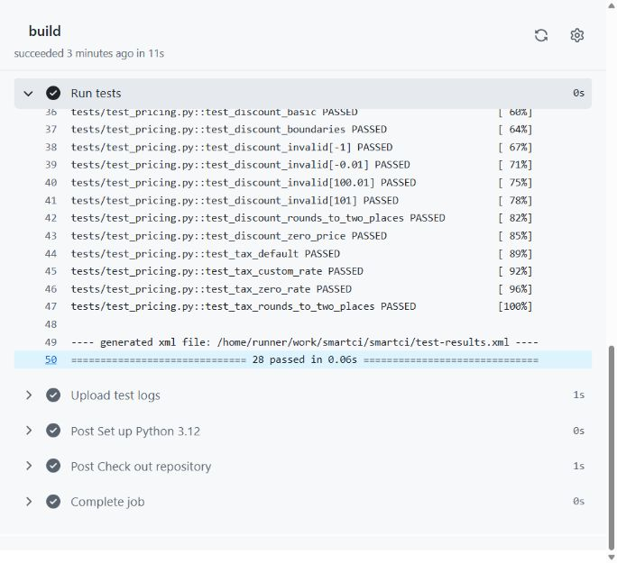
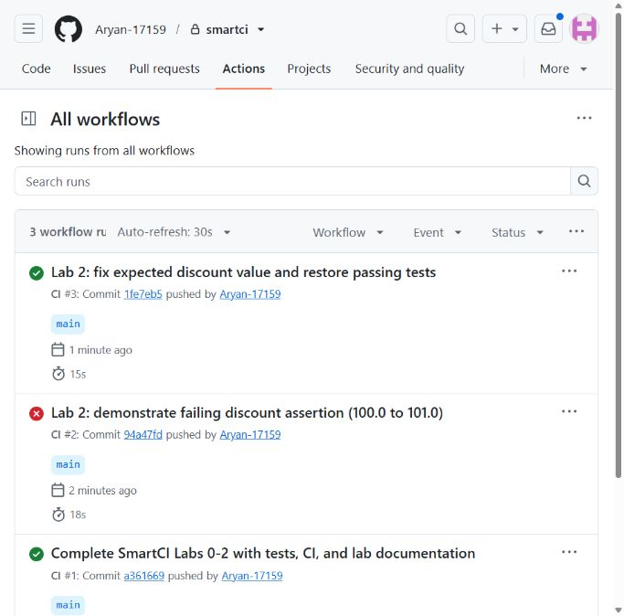
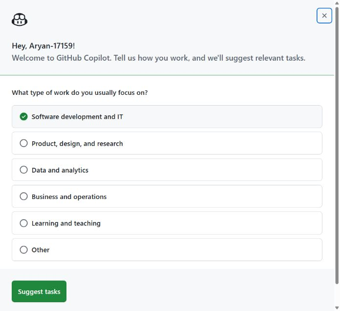

# SmartCI lab report

Source: the user-supplied `m4_0.pdf`, three pages covering Labs 0, 1, and 2.
Prepared on 14 October 2026.

## Lab 0: Setup and project folder

The project includes `src`, `tests`, `scripts`, `ml`, `infra`, `ansible`, and
`.github/workflows`. `.gitignore` excludes virtual environments, Python caches,
pytest caches, and generated CI logs. Empty folders are preserved with `.gitkeep`.

A fresh Python 3.12 virtual environment was used for local verification.
Installation and GitHub push commands are in the README. VS Code extension
installation, Copilot sign-in, and GitHub authentication are user-account setup
steps. Publishing is now complete. Copilot Chat was opened but account setup
blocked a response; see the status below.

## Lab 1: Application and tests

`apply_discount` checks that the percentage is in the inclusive range 0-100,
applies it, and rounds to two decimal places. `add_tax` applies 18% by default.
`Cart.total` sums unit price times quantity, applies the discount, and adds tax.
`Inventory` supports accumulating stock and removing available stock, raising
`ValueError` when insufficient stock is requested.

For the required cart example, two pens at 50 give a subtotal of 100.
A 10% discount gives 90. Adding 18% tax gives **106.20**.

There are 28 collected test cases:

- Pricing: 12 cases covering normal discounts, both boundaries, four invalid
  percentages, rounding, zero price, default tax, a custom rate, and zero tax.
- Cart: 8 cases covering discount, empty cart, quantity, multiple products,
  complete discount, invalid discount propagation, independent carts, and
  repeated totals without mutation.
- Inventory: 8 cases covering new stock, accumulated stock, partial and complete
  removal, insufficient stock without mutation, missing products, separate
  products, and independent inventory instances.

Local test evidence is provided in [evidence](evidence/README.md). The delivered
test file contains the correct assertion and the normal suite passes.

## Lab 2: Baseline CI pipeline

The workflow is `.github/workflows/ci.yml`:

1. `name: CI` gives the workflow its Actions-tab name.
2. `on: [push, pull_request]` runs it when commits are pushed or pull requests
   are opened or updated.
3. `permissions: contents: read` limits the workflow token to reading repository
   contents.
4. `jobs: build` defines a job that runs on a fresh `ubuntu-latest` runner.
5. `timeout-minutes: 10` bounds the job duration.
6. `actions/checkout@v4` checks out repository files; `fetch-depth: 0` downloads
   full history for later Git-diff exercises.
7. `actions/setup-python@v5` selects Python 3.12.
8. `python -m pip install -r requirements.txt` installs the listed dependencies.
9. `shell: bash` selects Bash for the test step. `set -o pipefail` makes the
   pipeline fail when pytest fails, even though `tee` successfully writes output.
10. `python -m pytest -v --junitxml=test-results.xml` runs the tests and records
    machine-readable results. `2>&1 | tee build.log` displays and saves output.
11. `if: always()` on the upload step preserves logs even after a failing test.
    Artifacts include the run ID and attempt number and are retained for 14 days.

### What is the use of a red run?

A red run means a workflow or job did not complete successfully. In this lab,
the intentionally wrong assertion demonstrates that CI actually detects a test
failure and propagates its nonzero exit status through the log pipeline. It
helps locate the failing behavior before a change is accepted. A failing required
status check can prevent merging when branch protection is configured; a red run
by itself does not automatically configure or enforce branch protection.

The demonstration replaces:

```python
assert apply_discount(100, 0) == 100.0
```

with:

```python
assert apply_discount(100, 0) == 101.0
```

The function correctly returns 100.0 because a 0% discount leaves 100 unchanged.
The failure is in the expected test value. Restore `100.0`; changing the function
to return 101.0 would make the application incorrect.

### Where does GitHub Actions show the error?

Go to **repository > Actions > CI > failed run > build > Run tests**.
The test log identifies `tests/test_pricing.py::test_discount_boundaries`, shows
the assertion mismatch `assert 100.0 == 101.0`, and ends with a failed-test summary
and a nonzero exit-code message. The failed step and job have red status icons.
The run summary's artifacts also provide `build.log` and `test-results.xml`.

### Completed GitHub experiment

Repository: [Aryan-17159/smartci](https://github.com/Aryan-17159/smartci) (private).
All runs below occurred on 14 October 2026 on `main`.

- [Baseline green CI #1](https://github.com/Aryan-17159/smartci/actions/runs/38527234943),
  commit `a361669`: **28 passed**, total workflow duration **17s**.
  The **Install dependencies** step displays **5s** in GitHub Actions.
- [Intentional red CI #2](https://github.com/Aryan-17159/smartci/actions/runs/38528095257),
  commit `94a47fd`: changed the expected boundary value from **100.0 to 101.0**.
  **Run tests** failed with **1 failed, 27 passed**, exit code **1**. Duration: **18s**.
- [Corrected green CI #3](https://github.com/Aryan-17159/smartci/actions/runs/38528235235),
  commit `1fe7eb5`: restored **100.0**. **All 28 tests passed**. Duration: **15s**.
- [Checkpoint tag: lab2](https://github.com/Aryan-17159/smartci/tree/lab2).

The red run is preserved in history. The submitted source contains the correct
assertion. The original local green/red/green runs are retained separately.

### Exact error location and diagnosis

Open [the failed Run tests log](https://github.com/Aryan-17159/smartci/actions/runs/38528095257/job/115733143363#step:5:64).
Navigate **Actions > CI > failed run #2 > build > Run tests**.
The assertion is in **tests/test_pricing.py, line 11**, inside
**test_discount_boundaries**. The function returned **100.0**, while the deliberately
incorrect test expected **101.0**. The log shows **assert 100.0 == 101.0** and
highlights **Process completed with exit code 1** below the failure summary.

The Upload test logs step still succeeds because it uses `if: always()`; that
does not turn the failed job green. The Node.js deprecation warning and Ubuntu
image notice are separate runner messages, also present in successful runs.
They did not cause this red run.

### Screenshots from the actual repository

Baseline green run:



Measured baseline installation duration:



Intentional red run:



Exact assertion failure and exit code:



Corrected green test output:



Green, red, and corrected green runs together:



### Saved logs and workflow explanation

- [Actual failed Run tests log excerpt](evidence/github-red-run.txt)
- [Actual corrected Run tests log excerpt](evidence/github-fixed-green.txt)
- [Every nonblank workflow line explained](WORKFLOW_EXPLANATION.md)

### Copilot Chat status

Copilot Chat at `github.com/copilot` was opened for the requested explanation.
GitHub displayed **Setting up your Copilot license** and **Please check back in a
few minutes**. Skipping and closing the welcome setup failed to save; chat access
remained blocked. No Copilot-authored answer is claimed. A complete independently
written explanation and the ready-to-send prompt are in `WORKFLOW_EXPLANATION.md`.
The remaining account-side action is to finish Copilot setup and submit the prompt
once the service becomes available.



## References

- Supplied assignment: `m4_0.pdf`, pages 1-3.
- [Building and testing Python](https://docs.github.com/en/actions/tutorials/build-and-test-code/python)
- [Using workflow run logs](https://docs.github.com/en/actions/how-tos/monitor-workflows/use-workflow-run-logs)
- [Checkout action](https://github.com/actions/checkout)
- [Setup Python action](https://github.com/actions/setup-python)
